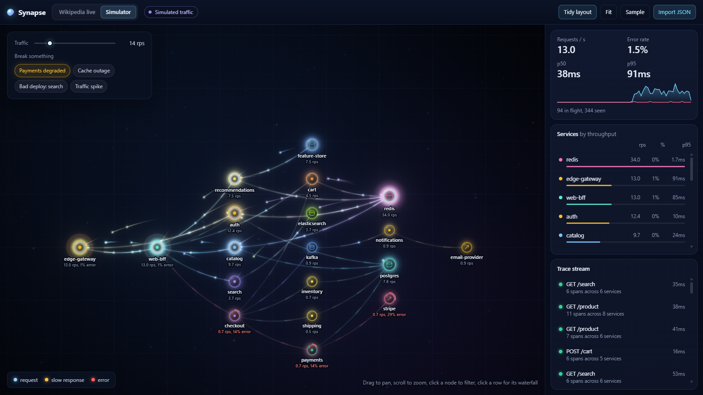
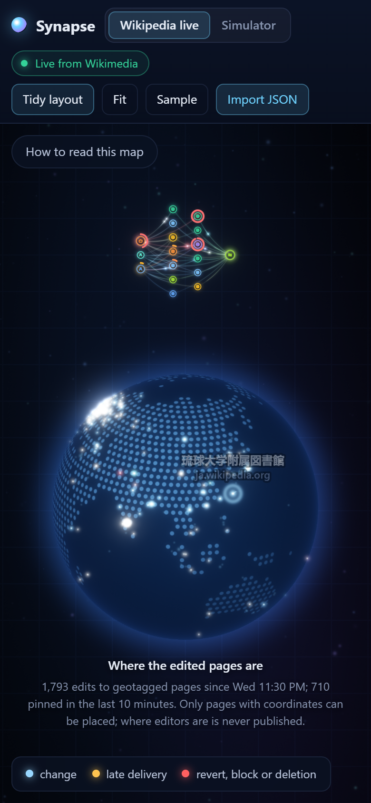

<div align="center">

# Synapse

**A zero-backend trace explorer, pointed at the real world.**<br>
Watch every edit on every Wikimedia wiki flow through a live service map and land on a globe, or drop in your own OpenTelemetry traces. Entirely in the browser.

TypeScript · WebGL2 · Canvas · zero runtime dependencies · ~51 kB gzipped

**[Open the live demo →](https://clark719664.github.io/synapse/)**

[](https://github.com/clark719664/synapse/actions/workflows/ci.yml)
[](https://github.com/clark719664/synapse/actions/workflows/deploy.yml)


*Live mode: each particle is a real change on a Wikimedia wiki. Editors on the left, the wiki it changed in the middle, EventStreams on the right. Pages with coordinates arc onto the globe; red is a revert, block or deletion.*

</div>

---

Every APM vendor has an animated service map; none of them are something you can open in a tab. Synapse is the lightweight version, and it ships with something real to watch: Wikimedia's public stream of every edit, page creation and log action across hundreds of wikis, mapped onto the same service-map and span model it uses for your own traces.

## Gallery

| | |
|:--:|:--:|
| <br>**One live change, as a trace**: who made it, which wiki recorded it, and how long EventStreams took to deliver it to this browser, with the edit summary, size change and links to the page and the diff | <br>**Simulator**: a 17-service e-commerce backend with the "Payments degraded" incident injected; failures turn red and cascade back towards the edge |

<p align="center"><br><em>On a phone the globe stacks under the network.</em></p>

## Live mode

The page opens on **Wikipedia live**: [Wikimedia EventStreams](https://stream.wikimedia.org/?doc) over server-sent events. It is keyless and CORS-enabled, so the static page reads it straight from the browser; there is no server of ours in that path.

**What you see is live.** Each change is drawn the moment it reaches your browser. Nothing is buffered, resampled or replayed on screen.

**How a change becomes a trace.** Every event is mapped to three asynchronous spans:

```
editor kind ──► wiki host ──► EventStreams
(registered,     (en.wikipedia.org,   delivery span: event time → arrival in this tab,
 anonymous,       www.wikidata.org,    i.e. the measured lag)
 bots)            … busiest 12, rest
                  as "other wikis")
```

- Reverts (recognised from MediaWiki's undo/rollback summaries in the busiest languages) and moderation logs (blocks, deletions, abuse-filter hits, protections) are the "errors" and travel red.
- **Bursts** are the incidents: a wiki whose 10-second rate reaches 3× its own slow-moving baseline (and at least 1 change/s) gets a dashed amber ring and a "Burst N×" tag, and goes into the Bursts log with its peak.
- The lag KPIs are delivery lag as measured against this device's clock.
- `categorize` events are automatic side effects of edits already in the stream; they are counted separately ("automatic category updates") and not drawn.

**The globe.** Wikimedia never publishes where editors are, so the globe shows where the *edited page* is: Wikipedia and Wikivoyage articles, Wikidata items and Commons files that carry coordinates. Coordinates come from each wiki's own API, batched (up to 50 titles a request), cached, rate-limited (the page makes at most one request a second, the collector two), and respectful of `maxlag` and HTTP 429 `Retry-After`. Fresh changes arc from their wiki's node to the spot and pulse; the last ten minutes stay as pins, and the last 24 hours show as per-place counts.

**Honest states.** The status pill says *Loading history*, *Live from Wikimedia*, *No events for N s* (stalled; it reconnects itself after 30 s), *Disconnected, retrying in N s* (explicit backoff), or *Paused while this tab is hidden* (after 30 s in the background). Wikimedia occasionally resets the stream; Chrome then logs `ERR_HTTP2_PROTOCOL_ERROR` and Synapse resumes from the last change it counted.

### Always-on history

A page only sees what happens while it is open, so a small collector ([`collector/collect.py`](collector/collect.py), Python standard library only) follows the stream around the clock and publishes a rolling history to the [`data` branch](https://github.com/clark719664/synapse/tree/data) once a minute.

The History card shows the last 10 minutes or hour per second, or the last 24 hours per minute, and is exact:

1. The collector files every change by its own timestamp and only commits a second once it is 15 s old, by which time no earlier change can still arrive. Its snapshot is complete for every second before its `boundary`.
2. Every connection, including after a drop, a restart or a night asleep, asks Wikimedia to replay from just before the boundary, and changes are de-duplicated by id.
3. The page loads the snapshot, then replays from the same boundary itself. Replayed changes go into the counts but are never animated; once event time keeps pace with the clock, the stream is live. That test compares rates, not timestamps, so a wrong device clock cannot fool it.
4. Time nobody covered (before the collector started, or anything Wikimedia could no longer replay) is shown as a gap and stated in minutes, never filled with zeros.

The collector is built to stay out of the way: one thread, one streaming connection, idle CPU priority, one instance at a time (a lock file), about 20 MB of memory and around 1% of one core when caught up. It downloads Wikimedia's full stream, roughly 3 GB a day. The snapshot is about 230 KB (about 50 KB compressed).

**Running it** (any machine with Python 3.10+ and `git` credentials that can push to the repository):

```bash
python collector/collect.py
```

State, logs and the publish checkout live in `collector/.data/` (git-ignored). Environment overrides: `SYNAPSE_REMOTE` (where to push), `SYNAPSE_DATA_DIR`, `SYNAPSE_PUBLISH_S` (publish interval, default 60), `SYNAPSE_LOG_FILE=1`. On Windows it is started at sign-in by a Startup-folder shortcut (`Synapse collector`) that runs `pythonw.exe collector\collect.py` with no window.

**Stopping it:** end the `pythonw.exe` (or `python`) process whose command line contains `collect.py`, for example in PowerShell:

```powershell
Get-CimInstance Win32_Process -Filter "Name='pythonw.exe'" | Where-Object { $_.CommandLine -like '*collect.py*' } | ForEach-Object { Stop-Process -Id $_.ProcessId }
```

and delete `Synapse collector` from `shell:startup` so it does not start again at the next sign-in. Restarting later is safe: it resumes from its saved boundary and replays what it missed, as long as Wikimedia still has it. With the collector stopped, the page still runs live; the History card then says the collector's history is unavailable and counts from when you opened the page.

## What it does

**Service map**
- Builds the service graph incrementally from spans: an edge exists wherever a span's parent lives in a different service. Entry points are detected from root spans.
- **Tidy layout** (default): one column per call depth, each column ordered to cut edge crossings (a few barycentre sweeps, as in Sugiyama), busiest first on ties; long columns wrap into staggered sub-columns. Nodes glide to their slots and can still be dragged. Press `L` or the *Tidy layout* button for the free force-directed layout with depth columns.
- Node ring colour encodes error rate, an arc shows the failing share, size follows throughput, and data stores, third parties, editors and wikis get their own glyphs. Labels make way for burst tags and never overlap one another.

**Rendering**
- WebGL2 into a half-float scene buffer (8-bit fallback), then a dual-filter bloom and tone mapping over a background with a world-anchored grid and a parallax dust field.
- Glass node orbs with rim light and halo, edge beams with pulses flowing in the direction of traffic, particles with comet trails, arrival flares on the receiving node.
- The globe is an orthographic sphere drawn in a fragment shader: a dot-matrix land mask rasterised from Natural Earth (public domain) into a 5.8 KB run-length table, ocean shading, rim light and atmosphere. Drag it to spin it.
- `prefers-reduced-motion` freezes ambient motion: no background drift, edge pulses, pulsing, trails, flares, arcs, globe spin or camera easing.

**Particles**
- Every synchronous call becomes two particles: a request leaving the caller when the child span starts and a response returning when it ends. Asynchronous hops (consumer spans) get a single particle that leaves once the previous hop has landed. Positions are derived from the clock each frame, never stored.
- Colour encodes outcome: blue request, amber when a span ran more than 3× the edge's rolling p50, red on error.

**Observability workflow**
- Rolling KPIs, the per-node table, and a stream of recent traces; click a trace for its waterfall (instant events shown as diamonds) with the selected span's attributes beside it.
- Hover any node or edge for throughput, error rate and latency percentiles.

**Data in**
- **Wikipedia live**, as above.
- **Import** OTLP/JSON (`resourceSpans`), Jaeger UI exports (`data[].spans`) and Zipkin v2 arrays, by button or drag-and-drop. Malformed records are counted and skipped.
- **Simulator**: a 17-service e-commerce backend with six routes, Poisson arrivals, log-normal latencies, probabilistic fan-out and failure propagation. Four injectable incidents: payments degraded, cache outage, bad deploy, traffic spike. Seeded, so bugs are reproducible.

## Run it

```bash
npm install
npm run dev        # http://localhost:5173
npm test           # 84 unit tests
python -m unittest discover -s collector   # 13 collector tests
npm run build
```

Requires WebGL2 (every current browser). URL parameters: `?source=sim` opens the simulator; `?rps=30` sets simulated traffic and `?scenario=redis-down,bad-deploy` pre-arms incidents (both imply the simulator).

### Getting your own traces in

```bash
# OpenTelemetry Collector → file exporter (otlp json)
exporters:
  file:
    path: ./traces.json
# then wrap the lines in {"resourceSpans":[...]} or use otelcol's json_lines → jq -s '{resourceSpans: map(.resourceSpans[])}'

# Jaeger UI → "Download JSON" on any trace or search result
# Zipkin → GET /api/v2/traces?limit=100 → flatten with jq 'flatten'
```

## How it works

```
 Wikimedia stream ─► wikimedia.ts ─┐
 file / simulator ─► parsers.ts ───┼─► Span[] ─► assembleTraces() ─► Trace[]
                                   │                                    │
 collector snapshot ─► history.ts ─┘  (counts only)                     │
                      ┌──────────────────── Engine.update() every frame ┘
                      ▼
          Topology.ingest(trace)          → nodes, edges, rolling stats (RateCounter, LatencyWindow)
                      │ returns Transfer[] (parent.service → span.service)
                      ▼
          particles (request + response, or one per async hop)
                      │
          ┌───────────┴───────────┐
   layered / force layout    GlRenderer.render()               Overlay.render()
                             dust · globe · edges · particles   rings · glyphs · labels · tags
                             orbs · pins · bloom · tone map      tooltips · hit-testing
```

**The clock is virtual.** `VirtualClock` reports wall-clock time live and a scaled, pausable timeline in replay. Everything downstream only asks `clock.now()`, which is why the same code path serves a live stream, a simulation and a file of last Tuesday's traces.

**Statistics are windowed, not cumulative.** `RateCounter` is a ring of per-second buckets; `LatencyWindow` keeps a trailing 30 seconds of samples and answers nearest-rank percentiles on demand.

## Project layout

```
src/
├── main.ts              wiring, interaction (pan/zoom/drag/drop, globe drag), render loop
├── app/                 engine (clock, sources, topology, particles, KPIs), clock, palette
├── model/               normalised spans, OTLP/Jaeger/Zipkin parsers, topology, stats
├── live/
│   ├── wikimedia.ts     recent-change parsing, editor/revert classification, change → spans, host slots
│   ├── feed.ts          SSE connection with honest states and explicit backoff
│   ├── source.ts        wires stream, history, bursts and geo into the engine
│   ├── history.ts       collector snapshot validation, exact rolling per-second/per-minute counts
│   ├── bursts.ts        per-wiki rate anomaly detector
│   └── geo.ts           polite, batched coordinate lookups
├── geo/                 globe camera, Natural Earth land mask
├── layout/              tidy layered layout, force-directed layout
├── sim/                 the demo call-tree templates, generator, incidents
├── render/              WebGL2 renderer, Canvas 2D overlay, glyphs, curves, camera
└── ui/                  topbar, sidebar, history card, waterfall, map panels, styles
collector/               always-on history collector (Python, stdlib only) and its tests
test/                    unit tests
```

## Design notes

- **Why not D3?** The layouts here do one specific thing each (depth columns), and rendering thousands of moving particles belongs in WebGL, not an SVG scene graph.
- **Why two canvases?** Additive glow and bloom look right in WebGL and wrong with Canvas compositing; crisp text looks right in Canvas 2D and is painful in WebGL. Stacking them costs nothing.
- **Why constant particle travel time?** The real duration is in the span (and the gap between a request and its response). Travel time proportional to latency would make fast edges unreadable and slow ones tedious.
- **Why replay instead of a fresher snapshot?** A static site cannot be pushed to every second. Replaying from the snapshot's exact boundary makes the page as current as the stream itself, whatever the snapshot's age, and the seam is exact because both sides count by event time and de-duplicate by id.
- **What is deliberately not here:** a server of our own in the live path, OTLP/gRPC ingestion, metrics and logs.

## Roadmap

- Live OTLP/HTTP ingestion via a tiny local relay (the browser can't listen on a port)
- Span attribute search and filtering
- Critical-path highlighting in the waterfall
- Export the current view as PNG / the current trace as OTLP

## License

MIT. Land outlines from [Natural Earth](https://www.naturalearthdata.com/) (public domain). Live data from the [Wikimedia Foundation](https://wikimediafoundation.org/)'s public EventStreams and APIs, under their respective terms.
