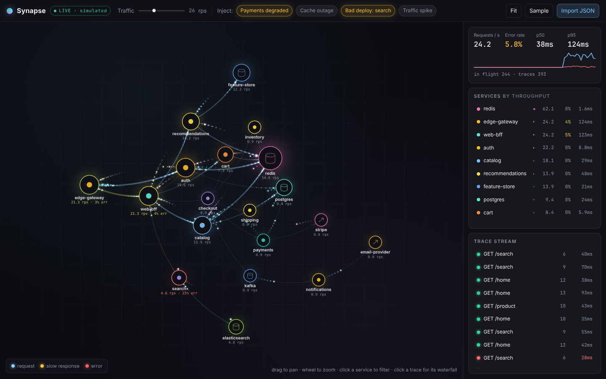
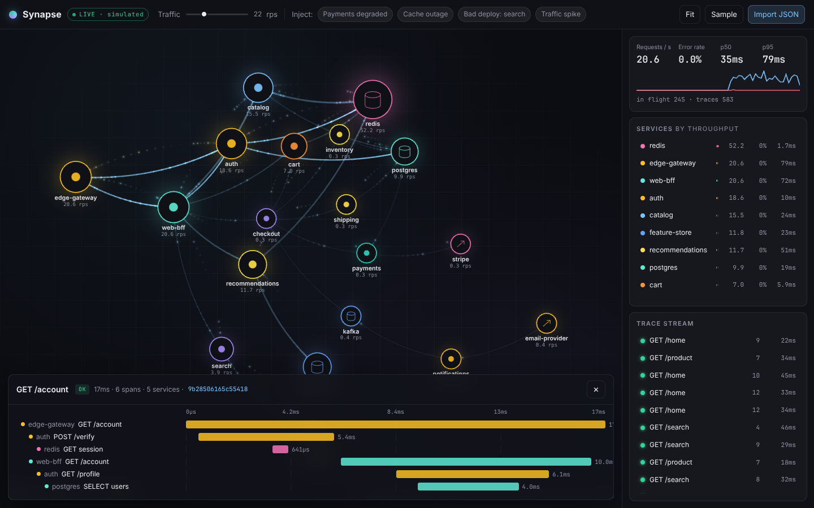
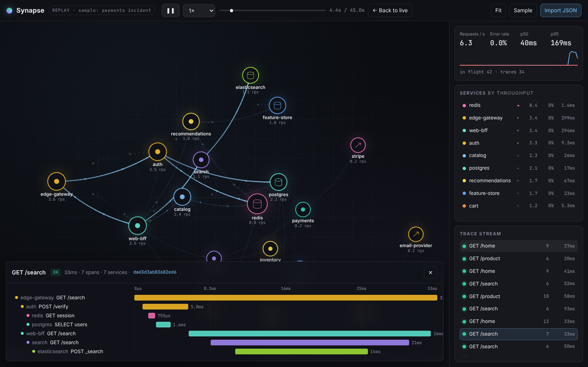

<div align="center">

# Synapse

**A zero-backend OpenTelemetry trace explorer.**<br>
Watch every request travel through your service map, then open its span waterfall. Entirely in the browser.

TypeScript · WebGL2 · Canvas · zero runtime dependencies · ~21 kB gzipped

[](https://github.com/clark719664/claudes-dream/actions/workflows/ci.yml)




*Live simulation with the "Payments degraded" incident injected: slow responses turn amber, failures turn red, and the error cascade is visible as it propagates back towards the edge.*

</div>

---

Every APM vendor has an animated service map; none of them are something you can open in a tab and point at a JSON file. Synapse is the lightweight version: drop an OTLP, Jaeger or Zipkin export onto the page and it replays your traffic through a force-directed graph of your services, one glowing particle per inter-service call, with a span waterfall a click away. Or run the built-in simulation of an e-commerce backend and break things on purpose.

## Gallery

| | |
|:--:|:--:|
| <br>**Span waterfall** — click any trace in the stream; its path lights up on the map and every span is laid out by time, indented by call depth | <br>**Replay** — imported traces play back on a scrubbable, speed-controlled virtual clock; the sample replays a 45-second incident |

## What it does

**Service map**
- Builds the service graph incrementally from spans: an edge exists wherever a span's parent lives in a different service. Entry points are detected from root spans.
- Force-directed layout with a **flow bias**: nodes are attracted to a column matching their call depth, so gateways land on the left and data stores on the right without manual placement. Drag any node; the rest reflow.
- Node ring colour encodes error rate, ring size encodes throughput, and data stores and third parties get their own glyphs.

**Particles**
- Every inter-service call becomes two particles: a request leaving the caller when the child span starts, and a response returning when it ends. Positions are derived from the clock each frame, never stored, so pausing, scrubbing and speed changes are free.
- Colour encodes outcome: blue request, amber response when the span ran more than 3× the edge's rolling p50, red on error.
- Rendered as instanced sprites with additive blending and a short trail; edges are ribbons whose width and brightness follow traffic. Text and rings are drawn on a Canvas 2D layer above the WebGL canvas so they stay crisp.

**Observability workflow**
- Rolling KPIs (requests/s, error rate, p50, p95) with a 60-second sparkline of traffic and errors.
- Per-service table sorted by throughput; click to filter the map and the trace stream to one service.
- Live trace stream; click a trace for a waterfall with per-span service, operation, duration and status, and the trace's path highlighted on the map.
- Hover any node or edge for throughput, error rate and latency percentiles.

**Data in**
- **Import** OTLP/JSON (`resourceSpans`), Jaeger UI exports (`data[].spans`) and Zipkin v2 arrays, by button or drag-and-drop. The format is auto-detected; malformed records are counted and skipped rather than aborting.
- **Simulate**: a 17-service e-commerce backend with six routes, Poisson arrivals, log-normal latencies, probabilistic fan-out and failure propagation. Four injectable incidents: payments degraded, cache outage, bad deploy, traffic spike. Seeded, so bugs are reproducible.

## Run it

```bash
npm install
npm run dev        # http://localhost:5173
npm test           # 26 unit tests
npm run build
```

Requires WebGL2 (every current browser). URL parameters: `?rps=30` sets simulated traffic, `?scenario=redis-down,bad-deploy` pre-arms incidents.

### Getting your own traces in

Any of these produce a file Synapse can read:

```bash
# OpenTelemetry Collector → file exporter (otlp json)
exporters:
  file:
    path: ./traces.json
# then wrap the lines in {"resourceSpans":[...]} or use otelcol's json_lines → jq -s '{resourceSpans: map(.resourceSpans[])}'

# Jaeger UI → "Download JSON" on any trace or search result
# Zipkin → GET /api/v2/traces?limit=100 → flatten with jq 'flatten'
```

## How it works

```
  file / simulator ──► parsers.ts ──► Span[] ──► assembleTraces() ──► Trace[]
                                                                        │
                      ┌────────────────── Engine.update() every frame ──┘
                      │   release traces whose start ≤ clock.now()
                      ▼
          Topology.ingest(trace)          → nodes, edges, rolling stats (RateCounter, LatencyWindow)
                      │ returns Transfer[] (parent.service → span.service)
                      ▼
          particles.push(request @ span.start, response @ span.end)
                      │
          ┌───────────┴───────────┐
   ForceLayout.step()      GlRenderer.render()          Overlay.render()
   (columns by depth)      edges · halos · particles    rings · labels · tooltips · hit-test
```

**The clock is virtual.** `VirtualClock` reports wall-clock time in live mode and a scaled, pausable timeline in replay mode. Everything downstream only ever asks `clock.now()`, which is why the same code path serves a live simulation and a file of last Tuesday's traces, and why scrubbing is a `seek()` plus a particle purge.

**Statistics are windowed, not cumulative.** `RateCounter` is a ring of per-second buckets; `LatencyWindow` keeps a trailing 30 seconds of samples and answers nearest-rank percentiles on demand. Both are a few lines and allocation-light, which matters when they are updated for every span.

**The layout is deterministic.** Given the same insertion order and seed, `ForceLayout` produces the same picture; the test suite pins that down, along with the column ordering and sibling separation.

## Project layout

```
src/
├── main.ts              wiring, interaction (pan/zoom/drag/drop), render loop
├── app/
│   ├── engine.ts        clock + source + topology + particles + KPIs
│   ├── clock.ts         live / replay virtual clock
│   └── palette.ts       stable per-service colours, health colours
├── model/
│   ├── span.ts          normalised Span/Trace, assembleTraces()
│   ├── parsers.ts       OTLP, Jaeger, Zipkin → Span[] (auto-detected)
│   ├── topology.ts      service graph + per-node/edge rolling stats
│   └── stats.ts         RateCounter, LatencyWindow, EWMA
├── sim/
│   ├── topology.ts      the demo call-tree templates
│   ├── generator.ts     Poisson arrivals, log-normal latencies, failure propagation
│   └── scenarios.ts     injectable incidents
├── layout/force.ts      force-directed layout with depth columns
├── render/
│   ├── gl.ts            WebGL2: edge ribbons, halos, instanced particle sprites
│   ├── overlay.ts       Canvas 2D: rings, glyphs, labels, hit-testing
│   ├── curve.ts         Bézier edges shared by both layers
│   └── view.ts          pan/zoom camera with eased fit-to-bounds
└── ui/                  topbar, sidebar (KPIs/services/stream), waterfall, styles
test/                    parsers, stats, topology, generator, layout
```

## Design notes

- **Why not D3?** The force layout here is ~150 lines and does one specific thing (depth columns) that would otherwise be fought for in `d3-force` configuration. More importantly, rendering thousands of moving particles belongs in WebGL, not in an SVG scene graph.
- **Why two canvases?** Additive-blended glow looks right in WebGL and wrong with Canvas compositing; crisp text looks right in Canvas 2D and is painful in WebGL. Stacking them costs nothing.
- **Why constant particle travel time?** The real span duration is encoded as the gap between the request and response particles. Making travel time proportional to latency would make fast edges unreadable and slow ones tedious.
- **What is deliberately not here:** persistence, a backend, OTLP/gRPC ingestion, metrics and logs. This is the slice of an APM that benefits from motion, kept small enough to read in an afternoon.

## Roadmap

- Live OTLP/HTTP ingestion via a tiny local relay (the browser can't listen on a port)
- Span attribute search and filtering
- Critical-path highlighting in the waterfall
- Export the current view as PNG / the current trace as OTLP

## License

MIT
